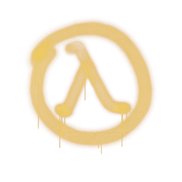
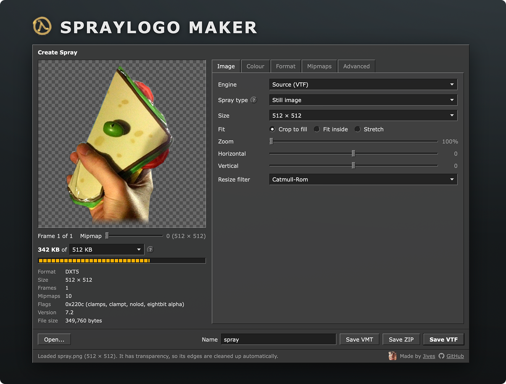

# Spraylogo Maker

Turn images, GIFs and videos into sprays for [Source](https://developer.valvesoftware.com/wiki/Source) and [GoldSrc](https://developer.valvesoftware.com/wiki/GoldSrc) games, including Team Fortress 2, Counter-Strike: Source, Garry's Mod, Counter-Strike 1.6 and Half-Life. Everything runs in your browser, so your files never leave your computer.

Special thank you to all the past and present [GitHub Sponsors](https://github.com/sponsors/JamesIves) 💖.

<!-- sponsors --><!-- sponsors -->

## Getting Started 🚀

1. Open [Spraylogo Maker](https://jamesiv.es/spraylogo-maker/) and drop an image, GIF, video, TGA or existing spray onto the preview. Several images at once become an animation.
2. Pick the **Engine**: **Source** makes a VTF, **GoldSrc** makes a `tempdecal.wad`.
3. Pick a **Spray type**. Each one sets sensible defaults, which you can tweak in the tabs.
4. Keep the size meter under the line, then save.

> [!TIP]
> The spray types cover the common kinds of spray:
>
> - **Still image**: mipmaps keep it sharp up close and far away.
> - **Animated**: frames are retimed to the game's fixed speed of about 5 frames a second. Use **Fit to limit** to drop frames evenly until it fits.
> - **Fading**: as players walk away the spray either fades out gradually between two mipmaps, or switches to other images, each from its own mipmap.
> - **Pixel art**: nearest neighbour scaling, uncompressed formats and point sampling keep hard pixel edges.
>
> Any spray type can be transparent. When the image has transparency, Source sprays use DXT5, halos left over from the image's old background are removed, and colour is filled in under transparent areas so the game doesn't blend black or white into the outline.

### Source Games

In Team Fortress 2, open **Options**, go to **Multiplayer** and import the `.vtf` from under the spray preview. For other Source games, save the zip and copy its `materials` folder into the game's folder (for example `Counter-Strike Source/cstrike`), then pick the spray in **Options** > **Multiplayer**.

> [!IMPORTANT]
> Sprays over 512 KB are ignored by the game. Older Source games and mods allow 120 KB; pick that limit from the size meter. VTF version 7.2 works in every Source game.

### GoldSrc Games

Save the spray and put `tempdecal.wad` in the game's folder, such as `cstrike` for Counter-Strike or `valve` for Half-Life. The game rewrites this file whenever you change your spray in the options, so make it read-only once it's in place.

> [!NOTE]
> GoldSrc sprays are a single image with up to 255 colours and one transparent colour, and no more than 14,336 pixels. Some servers only accept 64 × 64, which works everywhere.

## Contributing 🛠️

Development setup, the project's structure and coding standards are in [CONTRIBUTING.md](CONTRIBUTING.md).

## Acknowledgements 📚

- [VTFLib and VTFEdit](https://github.com/NeilJed/VTFLib), the reference for the VTF header layout, formats and flags.
- [cs16forge's GoldSrc format notes](https://github.com/cs16forge/goldsrc-formats), for the `tempdecal.wad` layout and size rules.
